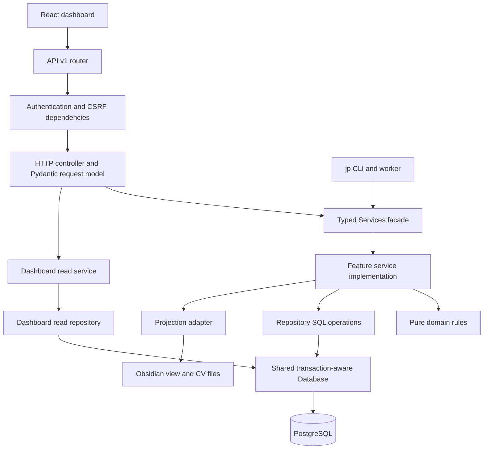

# Reading and running JobPilot

JobPilot has a React dashboard, a Python HTTP API, a PostgreSQL database and a separate application worker. The browser asks the backend for data; it never reads PostgreSQL itself. PostgreSQL is authoritative. The Obsidian vault is a generated view, with user notes preserved below the notes marker.

## Frontend

For a beginner explanation of every API method, request types, sessions and errors, read [the frontend API walkthrough](frontend-api-walkthrough.md).

Start at `frontend/src/main.tsx`. It mounts React with the application providers. `app/App.tsx` selects screens by URL; `pages/` composes those screens. Reusable visual controls live in `components/ui/`, while application-specific parts live in `features/`.

A component is a function that returns JSX. A custom hook is a function starting with `use` that shares React behavior such as state or subscriptions. A utility is an ordinary function; it does not need React. Folder names do not create runtime behavior—imports connect modules.

`hooks/useAction.ts` wraps TanStack Query mutations: a component calls `mutate`, the API request runs, and the hook exposes `isPending`, `data` and `error`. On success it shows a toast and invalidates relevant cached data. `app/live.ts` listens to server events and refreshes displayed data. `utils/format.ts` and `utils/humanize.ts` turn backend data into readable text.

`components/ui/styles.ts` exports `ui`, an object of Tailwind class strings. `className={ui.input}` retrieves one string and applies it to an input. `utils/cn.ts` combines optional classes and resolves Tailwind conflicts. There is no custom rendering framework behind this object.

For a profile section save:

1. `features/profile/ProfileSections.tsx` holds the editable draft and renders the form.
2. The submit button explicitly uses `type="submit"`; ordinary and icon buttons use `type="button"`.
3. `save.mutate(entries)` gives a snapshot to the mutation hook. Inputs and add/remove controls are disabled while it saves.
4. `api/api.ts` sends a PUT request to `/api/v1/profile/sections/education` with the session's CSRF header.
5. A successful response updates the form's saved baseline. Background refreshes do not replace an unsaved draft.

## Backend

FastAPI supports a layered design with [APIRouter](https://fastapi.tiangolo.com/tutorial/bigger-applications/); it does not prescribe Express's file names or require MVC. This project now separates those responsibilities explicitly:



For the same profile save, `api/v1/router.py` registers `controller/profile.py`, where the endpoint decorator sits directly above `profile_section`. `dto/requests.py:ProfileSection` validates the request body. The controller calls `application_service.profile_section_set`. That method in `service/application.py` opens the transaction and forwards to `service/profile.py`. The implementation validates the section using pure domain code, saves it, derives related profile values and records events. The transaction commits all those related changes together.

`service/application.py` is a facade: it exposes stable typed methods while delegating implementations to smaller modules. The same API is used by HTTP, CLI and workers. The internal feature objects must not be called directly because the facade owns transaction/context-manager boundaries.

`middleware/auth.py` distinguishes human cookie sessions from bearer requests. Approval routes require a human session. `middleware/security.py` handles allowed hosts, body limits and response headers. `middleware/errors.py` converts failures to the stable `{error: ...}` response.

`config/settings.py` reads environment configuration. `config/runtime.py` constructs the API's shared objects and services. `main.py` installs middleware and routers, opens/closes the DB pool during lifespan, and serves the built frontend. `server.py` starts Uvicorn. The worker is a separate process.

## PostgreSQL

The database is not a Python folder or JSON file. It is a running PostgreSQL server, listening on `127.0.0.1:5433`, persisting its files in `data/pgdata/`. `.env` tells psycopg how to connect. Credentials stay private.

There is no SQLAlchemy/Prisma ORM. SQL migrations define tables. `entity/job.py` describes the jobs table columns and `entity/profile.py` describes a profile row. Repositories construct these typed records when reading complete entities; partial query projections remain dictionaries. `dto/requests.py` and `dto/responses.py` are HTTP contracts, not database entities. A Python dictionary returned by psycopg is a database row; it is validated/shaped separately for the HTTP response.

| Tables | Purpose |
|---|---|
| `companies`, `boards`, `jobs` | Employers, job-site policy and individual job postings |
| `tasks` | Queue entries with leases and worker heartbeat information |
| `job_forms` | Inventories, answer plans and verification state |
| `approvals`, `applications` | Draft-bound user approval and confirmed submissions |
| `profile`, `facts`, `answers` | Owner information and reusable answers |
| `cv_tracks`, `cv_versions` | CV metadata and references to immutable stored files |
| `job_events`, `cost_ledger` | Audit events and usage records |
| `automation`, `runtime_settings`, `worker_processes` | Start/Stop, configuration and worker status |
| `domain_pacing`, `budget_reservations`, `board_daily_usage` | Admission limits and browser pacing |
| `projection_dirty`, `cv_commit_jobs`, `cv_commit_versions` | Durable pending projection and CV commit work |
| `browser_sessions`, `browser_hands_usage`, `recipe_suggestions` | Browser session tracking, action usage and reviewed recipes |

A foreign key connects related rows: `jobs.company_id` references `companies.id`; `tasks.job_id`, `job_forms.job_id`, approval job references and application job references point to `jobs.id`. Unique indexes prevent duplicate canonical job identities.

`repository/database.py` supplies:

- `one`: one row or `None`.
- `all`: a list of rows.
- `run`: execute a statement and return the affected row count.
- `transaction`: commit related work together, or roll it back on failure.

Queries use bound parameters, for example `WHERE job_id=%s` with `(job_id,)`. Values do not get concatenated into SQL. The pool reuses a limited number of connections. A ContextVar lets nested service calls reuse the current transaction connection; nested transactions use psycopg's savepoints. Projection callbacks run after the outer transaction commits.

`repository/` contains SQL reads and writes, including query construction and connection-scoped locks. Services choose what to do and own transaction boundaries; they call named repository methods instead of executing SQL. Controllers call services. `service/dashboard.py` delegates read operations to `repository/dashboard.py`.

Workers claim tasks using `FOR UPDATE SKIP LOCKED` inside the `dispatch()` task (`bin/jp-control`) under the `automation` row lock, so concurrent dispatches take different queue rows. The claim commits before work messages carrying the job ID are published over Redis to `bin/jp-worker`. Leases and heartbeats allow interrupted or lost jobs to become available again (90 s dispatch lease, 600 s run lease). These details are in `service/automation.py` and `worker/{tasks,runner,names}.py` (ADR 0012).

`bin/jp-migrate` applies `backend/migrations/*.sql` in filename order and records completed filenames in `schema_migrations`. It runs pending migrations once. Do not edit an already-applied migration to change the current database; add a new migration. This folder refactor requires no schema changes.

## Running and checking

First-time setup is in the root README. With dependencies, PostgreSQL (`infra/pg-init.sh`) and Redis (`infra/redis-init.sh`) already running:

```bash
cd jobpilot-core   # repository root
bin/jp-migrate
pnpm build:frontend
bin/jp-server
```

Open http://127.0.0.1:4100 for the dashboard or http://127.0.0.1:4100/docs for Swagger. The protected OpenAPI JSON is at http://127.0.0.1:4100/openapi.json. Swagger lists all `/api/v1/...` endpoints by feature and shows inputs/outputs. Existing `/api/...` URLs still work as compatibility aliases. If a server already owns that port, use the running server rather than launching a duplicate. For automatic frontend refresh during development, keep the backend running and run `pnpm dev:frontend`, then open the Vite URL. Visit the backend URL first if the development dashboard needs a session.

For automation, run the three background processes in separate terminals (or install their launchd agents via `infra/*-launchd.sh`): `bin/jp-control` (dispatcher and sweeps), `bin/jp-worker` (job worker), and `bin/jp-beat` (safety-net scheduler). Starting the workers is separate from enabling automation in the dashboard. Enabling automation in the dashboard (`Start`) controls the database flag that allows dispatching. User approvals still govern submission.

```bash
pnpm --filter @jobpilot/frontend lint
pnpm --filter @jobpilot/frontend format:check
pnpm typecheck:frontend
pnpm build:frontend
backend/.venv/bin/ruff check backend/src backend/scripts backend/tests
backend/.venv/bin/ruff format --check backend/src backend/scripts backend/tests
backend/.venv/bin/mypy backend/src backend/scripts backend/tests
backend/.venv/bin/python -m unittest discover -s backend/tests -v
```

The mock dashboard server (`pnpm --filter @jobpilot/frontend exec vite --config vite.mock.config.ts`) uses an in-memory fake API for UI checks. It does not reach the real backend or submit applications.
